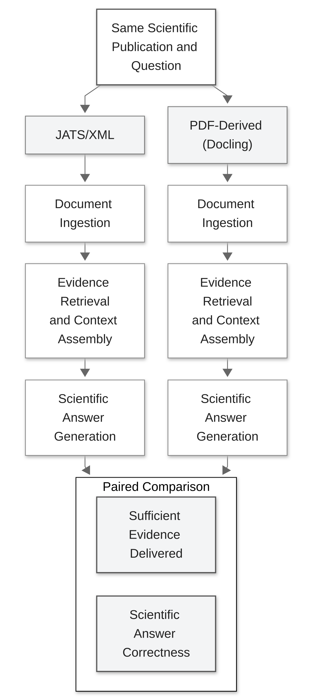

# Evaluating Reproducibility in Retrieval-Augmented Scientific Question Answering for Bioinformatics

[](https://github.com/ramakrishna-p21/bio-rag-evidence-reproducibility/actions/workflows/ci.yml)

Code, configuration, tests and analysis programs for a master's capstone (MS Bioinformatics) that
asks a simple question: **if the same scientific paper is given to an AI question-answering system
in two different digital forms, does the system find the same evidence and give the same answer?**

The experiments are finished and their results are frozen. This repository holds the software
that ran and evaluated them. It does not contain the study data or results; see
[Data availability](#data-availability).

## The idea in plain language

**Scientific question answering.** A researcher asks a precise question about a paper, such as
"which value did the authors report for X?" or "which method did they use?", and the system
should answer from the paper's evidence, not from guesswork.

**Retrieval-augmented generation (RAG).** A language model does not read a whole paper. Instead, the
paper is cut into short passages, a search step picks the passages most relevant to the question,
and only those passages are handed to the model, which then writes its answer. If the right passage
is missing, the model can only guess.

**Why the form of the paper matters.** A publication exists in several digital forms. A publisher
can supply structured text (an XML format called JATS, used by PubMed Central). The same paper is
also available as a PDF, whose text must be recovered by software that reads the page layout.
Tables, numbers, formulas, figure captions and reading order can come out differently in each form.
The search step and the language model only ever see one of these forms, so a difference in form can
change which evidence reaches the model, and so which answer it gives.

**Why this is a reproducibility question.** If an answer depends on a choice that is rarely
reported, such as which digital form of the paper was fed to the system, then results are hard to
repeat or compare. This study measures how much that one choice matters, holding everything else
fixed.

<p align="center"></p>

## Research questions

1. **Evidence delivery.** For the same paper and question, how does using JATS structured text
   versus text recovered from the PDF change whether the evidence needed to answer is preserved and
   actually delivered to the language model?
2. **Scientific answers.** How does the form of the paper change whether the model's answer is
   scientifically correct? Agreement between the two forms and consistency across repeated runs
   are examined as secondary analyses.

Findings are limited to the frozen corpus, benchmark and settings below. The study does not assume
that either form is better in general.

## Study design

| Element | What was used |
| --- | --- |
| Corpus | 50 bioinformatics papers, each in two matched forms: PubMed Central JATS XML, and the same paper's PDF converted with Docling (called `PDF_DOCLING`) |
| Benchmark | 391 questions written from the papers and checked against the original PDF: 86 for development and 305 held back for the final test. Answers fall in five classes: quantitative value, categorical conclusion, molecular or biological entity, bounded entity set, dataset or cohort |
| Passage preparation | Each form is split into passages of 384 tokens (a token is a word piece counted by the model's tokenizer). 192-token passages were a secondary variation |
| Search | BM25, a standard keyword-matching ranking method, over the passages of the question's source paper. A dense-embedding search (`BAAI/bge-base-en-v1.5`) was a secondary variation |
| Context given to the model | Whole passages from the top 20 results, as many as fit in a 2,048-token evidence budget, identical in size for both forms |
| Language model | Qwen3-8B, an open-weight model, run with deterministic (greedy) decoding and short structured answers |
| Repeats | Each question and form was generated 3 times; repeat 1 was fixed in advance as the primary observation |

### How results were judged

Each answer is traced back through the chain below, and judged at three stages:

```
paper → ingestion → canonical text → passages → search results → context → answer → evaluation
```

- **Stage A, evidence preserved.** Is the evidence needed to answer still present in the form of the paper?
- **Stage B, evidence delivered.** Did that evidence reach the model in the supplied context? This is the first of two co-primary outcomes.
- **Stage C, answer correct.** Is the model's answer scientifically correct against the benchmark? This is the second co-primary outcome.

The human review judgments (Stages A, B and C) were made by the researcher; the evaluation
protocol records that any AI assistance in preparing review material was advisory only. The statistical analysis, written in R,
compares the two forms question by question using a whole-paper bootstrap (resampling whole papers,
since questions from one paper are not independent), cluster-robust standard errors and Holm
adjustment for the two co-primary outcomes. Python scoring is authoritative; R reads a validated,
hashed table exported by Python.

### What was run and what was evaluated

| | Observations |
| --- | ---: |
| Generated in the final test (all arms) | 4,575 |
| **Confirmatory arm: 305 questions × 2 forms × 3 repeats (evaluated)** | **1,830** |
| Closed-book baseline, dense search and 192-token variations, full-corpus search (generated, **not evaluated**) | 2,745 |

Only the confirmatory observations entered official evaluation, under an approved amendment to the
evaluation protocol. The remaining arms are preserved but unevaluated; they are deferred work, not
results.

## Reproducibility approach

- Every input is chosen by explicit path and SHA-256 hash. Files are written once and re-read
  against their recorded hashes.
- Build manifests link each derived artifact to its inputs and to the code that made it, so an
  answer can be traced back to its exact context, passages and source file.
- Protected evaluation steps refuse to run unless an approval record names the exact source
  revision, protocol, custody exception and data batch (`approvals/`).
- The final analysis is pinned: R 4.6.1, a locked `renv` library, a fixed OpenBLAS kernel and a fixed
  seed. Its primary numeric result is compared byte for byte, so it is tied to that platform.
- Repeated generations under fixed greedy decoding test computational replay. They do not measure
  stochastic variability.

### Historical revisions

The results were not produced by the latest commit of this repository. This consolidated revision adds documentation and plotting code to the last analysis revision without changing
`src/`, `scripts/`, `configs/` or `analysis/`, and changes `tests/` in one place only: a pinned hash in a synthetic
regression test was updated after a documented wording change. The execution revisions are:

| Step | Revision |
| --- | --- |
| Generation (Colab L4) | `92af41e840b6667c5bf967a08e7ed61da078640a` |
| Stage A packet and review | `04eb08499f518c51a223019795cc20c19b6d1ca7` |
| Stage B review records | `8c0a8255d85409e717cde0c7757ee68efeb0002c` |
| Stage B ingestion, Stage C queue, first confirmatory evaluation | `71cc332766204c33af785b5b317c93eff3c394a6` |
| Final evaluation run and official R analysis | `cfa2ac026ed8f5e354bd45148774446ce07287cf` |

Commands that verify an official run must be run from the revision that run was approved for. They
will refuse this revision by design. See [docs/REPRODUCING.md](docs/REPRODUCING.md).

## Repository map

| Path | Contents |
| --- | --- |
| `src/biorag_repro/core` | Hashing, identities, build manifests, write-once file publication |
| `src/biorag_repro/corpus`, `benchmark` | Corpus manifest, benchmark construction and validation |
| `src/biorag_repro/documents` | JATS and PDF ingestion into one canonical document form |
| `src/biorag_repro/retrieval` | Chunking, BM25, dense search, context assembly |
| `src/biorag_repro/generation` | Generator settings, prompts, run and attempt records, environment checks |
| `src/biorag_repro/evaluation` | Stage A, B and C evaluation and the handoff to R |
| `src/biorag_repro/readiness`, `finaltest` | Authorization and custody checks that gate the protected runs |
| `analysis/` | The R statistical analysis, locked with `renv` |
| `figures/` | R code for the five statistical figures (no data, no generated figures) |
| `configs/` | Ingestion, environment and per-arm production settings |
| `scripts/` | Command-line programs; see [docs/REPRODUCING.md](docs/REPRODUCING.md) |
| `approvals/` | Researcher approval records that bind protected runs to exact revisions |
| `tests/` | Python tests on synthetic fixtures |
| `docs/` | Reproduction guide, data availability and limitations |

## Getting started

Python 3.11 is required. From a clone:

```bash
python -m pip install -e '.[dev,benchmark,bm25,dense]'
python -m pytest -q
python -m ruff check . && python -m ruff format --check .
```

For a CPU-only build install `torch==2.15.0` from `https://download.pytorch.org/whl/cpu` first. Some
tests need the pinned tokenizer and embedding snapshots (`BIORAG_QWEN_ROOT`, `BIORAG_BGE_ROOT`) and
are skipped without them. The R tests need R 4.6.1:

```bash
cd analysis && Rscript -e 'renv::restore()'
cd analysis && Rscript -e 'testthat::test_dir("tests/testthat")'
```

These steps use only synthetic fixtures. The guide explains which workflows need controlled data.

## Documentation

- [docs/REPRODUCING.md](docs/REPRODUCING.md): installation, supported workflows, every command-line
  entry point, historical checkouts, the Colab workflow, expected outputs.
- [docs/DATA_AND_LIMITATIONS.md](docs/DATA_AND_LIMITATIONS.md): what is and is not available, the
  custody exception, evaluation scope and scientific limitations.
- [figures/README.md](figures/README.md): regenerating the statistical figures from analysis outputs.

## Data availability

The corpus, benchmark questions and gold answers, generated answers, review and adjudication records
and the statistical result files are not in this repository. Decisions on what can be shared, and
under which terms, have not been made. No claim is made here that the full study can be reproduced
from public material.

## Scientific limitations

In brief (details in [docs/DATA_AND_LIMITATIONS.md](docs/DATA_AND_LIMITATIONS.md)): one open-weight
generator, one corpus of 50 papers, two forms of each paper and one PDF converter; a single
reviewer for the human judgments; only the confirmatory arm was evaluated; an approved custody
exception because the original external custody requirement could not be established; and numerical
results of the final R analysis tied to one platform.

## License status

No software license has been selected yet, and none is granted by this repository's public
visibility. The code is published for reading, review and checking the study; do not assume
permission to reuse or redistribute it until a license is added. Research-data licensing is a
separate, undecided matter.

## Citation and acknowledgments

Cite the software with [CITATION.cff](CITATION.cff). The manuscript is in preparation, so no paper
citation is given here yet. Advisor and institutional acknowledgments will be added with the
manuscript. Author and maintainer: Rama Krishna Pudota.
